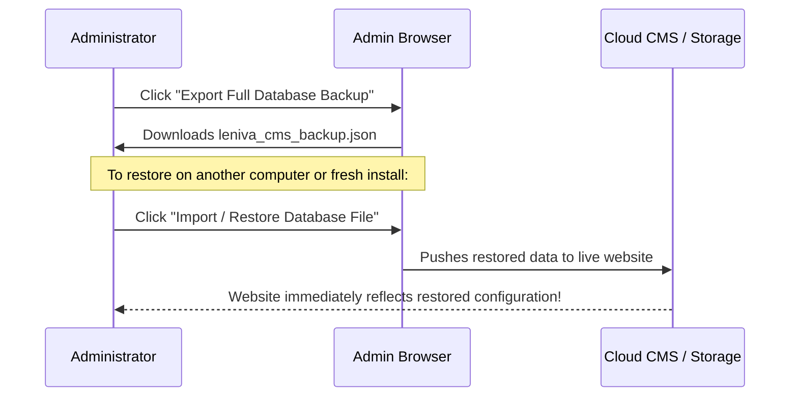

# Leniva CAD Solutions — Administrator Guide & User Manual

Welcome to the **Leniva CAD Solutions Master Administration Portal**. This document provides an exhaustive, step-by-step operational manual for managing all website content, product catalogs, interactive visual page editors, section visibility toggles, customer inquiries, quotes, blog articles, and live site settings.

---

## Table of Contents

1. [Access & Authentication](#1-access--authentication)
2. [Admin Dashboard Overview](#2-admin-dashboard-overview)
3. [Quotes & Customer Inquiries Management](#3-quotes--customer-inquiries-management)
4. [Product Catalog Management](#4-product-catalog-management)
5. [Page Section Enable / Disable Controls](#5-page-section-enable--disable-controls)
6. [Interactive Visual Page Editors](#6-interactive-visual-page-editors)
7. [Homepage Content & Hero Slider Editor](#7-homepage-content--hero-slider-editor)
8. [About Us Page Editor](#8-about-us-page-editor)
9. [Shop & Mega-Menu Navigation Editor](#9-shop--mega-menu-navigation-editor)
10. [CAD Software Management](#10-cad-software-management)
11. [Blog Publishing & Article Management](#11-blog-publishing--article-management)
12. [Live Site Settings, WhatsApp & Announcement Bar](#12-live-site-settings-whatsapp--announcement-bar)
13. [Database Backup, Restore & Cloud Sync](#13-database-backup-restore--cloud-sync)
14. [Troubleshooting & Frequently Asked Questions](#14-troubleshooting--frequently-asked-questions)

---

## 1. Access & Authentication

### 1.1 Admin Portal URL
You can access the admin control panel on any device by navigating to:
- **Production (Live Domain):** `https://your-domain.com/admin` (e.g. [leniva-cad-solutions-u6v5.vercel.app/admin](https://leniva-cad-solutions-u6v5.vercel.app/admin))
- **Local Development:** `http://localhost:5173/admin`

> [!NOTE]
> The admin portal features a zero-downtime, hybrid authentication engine. Even if backend databases or cloud APIs experience temporary network interruption, authorized administrators can always log in using offline-resilient local verification.

### 1.2 Default Credentials

| Field | Accepted Values |
|---|---|
| **Admin Username / Email** | `admin`   `leniva`   `viju@leniva3d.com`   `admin@lenivacadsolution.in`   `contact@lenivacadsolution.in` |
| **Default Password** | `Admin@Leniva2026!` *(or `admin123`)* |

### 1.3 Changing the Admin Password
1. Log into the Admin Portal.
2. In the top navigation bar, click on **Settings**.
3. Scroll down to the **Admin Security & Password** card.
4. Enter your new password and click **Update Password**.
5. The password will immediately update locally and automatically sync to your cloud store.

---

## 2. Admin Dashboard Overview

The top administrative toolbar gives you one-click access to all primary management modules:

```mermaid
flowchart TD
    Admin["Leniva Admin Portal"]
    Admin --> Leads["1. Leads & Inquiries"]
    Admin --> Catalog["2. Product Catalog"]
    Admin --> VisEdit["3. Visual & Section Editors"]
    Admin --> PageEdit["4. Page Content Editors"]
    Admin --> NavShop["5. Mega-Menu & Navigation"]
    Admin --> Content["6. Blog & Knowledge Base"]
    Admin --> System["7. Settings & Cloud Backup"]

    Leads --> Quotes["Quote Requests"]
    Leads --> Contacts["Contact Messages"]

    Catalog --> AddProd["Add / Edit Products"]
    Catalog --> SpecEdit["Technical Specifications"]
    Catalog --> BrochureMgr["Brochure PDFs"]

    VisEdit --> PrintersVE["3D Printers Section Toggles"]
    VisEdit --> ScannersVE["3D Scanners Section Toggles"]
    VisEdit --> CadVE["CAD Software Section Toggles"]

    PageEdit --> HomeEd["Hero Slider & Home"]
    PageEdit --> AboutEd["About Us Story & Team"]

    NavShop --> DropdownEd["Navigation Mega-Menus"]
    NavShop --> ShopPageEd["Shop Page Banner"]

    System --> WhatsApp["WhatsApp & Announcement"]
    System --> CloudSync["Export / Restore Backup"]
```

### Module Quick Reference

- **Quotes (`quotes`):** Live customer RFQ submissions, timeline, quantity, and status tracking.
- **Contacts (`contacts`):** General contact form inquiries.
- **Products (`products`):** Master e-commerce & showcase catalog for all 3D Printers, Scanners, Filaments, and CAD Software.
- **Home Editor (`home_editor`):** Panoramic hero carousel slides, company introduction, and homepage showcase cards.
- **About Editor (`about_editor`):** Complete editorial management of the About Us page.
- **Shop & Navigation (`shop_and_dropdown`):** Mega-menu category flyouts, quick shortcut links, and shop page headers.
- **CAD Software (`cad_software`):** Specialized licensing, pricing plans, and technical parameters for ARES, SketchUp, and Chaos suites.
- **Visual Section Editors (`printers_visual_edit`, `scanners_visual_edit`, `cad_visual_edit`):** In-context page previews with section-by-section enable/disable toggles.
- **Blogs (`blogs`):** Technical articles, printing guides, CAD tutorials, and announcements.
- **Settings (`settings`):** Contact numbers, email addresses, WhatsApp button, top announcement bar, and full database backup/restore.

---

## 3. Quotes & Customer Inquiries Management

### 3.1 Managing Quote Requests (RFQs)
When potential buyers click **"Request Quote"**, **"Get Pricing"**, or configure a machine on the website, their request is routed immediately into the **Quotes** tab.

#### Features Available:
1. **Status Workflow:** Each request can be toggled through:
   - `Pending / New` (Yellow)
   - `Contacted` (Blue)
   - `Quoted` (Purple)
   - `Closed / Won` (Green)
   - `Declined / Lost` (Slate)
2. **Detailed Breakdown:** Click on any quote row to view customer full name, direct phone number, company/organization, specific product configuration requested, quantity, procurement timeline, and customer notes.
3. **Internal Administrative Notes:** Add private internal follow-up notes (e.g. *"Sent formal quotation via email on 26 Oct, following up via phone"*).
4. **Direct Communication Buttons:** Click the **Phone** or **Email** icon next to any entry to dial or compose an email instantly.
5. **CSV Export:** Click **Export to CSV** at the top right to download all customer lead records into Microsoft Excel or Google Sheets.

### 3.2 Managing Contact Form Messages
Located under the **Contacts** tab, this stores all messages submitted via the Contact Us page, organized chronologically with direct reply shortcuts.

---

## 4. Product Catalog Management

The **Products** module controls every physical hardware and digital software product displayed across the store, product detail pages, and category pages.

### 4.1 Adding a New Product
1. Go to the **Products** tab.
2. Click **+ Add New Product**.
3. Choose the target category:
   - **FDM 3D Printers** (`fdm-3d-printers`)
   - **DLP 3D Printers** (`dlp-3d-printers`)
   - **Industrial LCD Printers** (`industrial-lcd-3d-printers`)
   - **3D Scanners** (`3d-scanners`)
   - **3D Printer Filaments** (`filaments`)
   - **CAD & Engineering Software** (`cad-software`)
4. Fill in the core information:
   - **Product Name:** (e.g. `Pratham 3.0 Rapid`)
   - **URL Slug:** (e.g. `pratham-3-rapid` — creates clean URL `/products/pratham-3-rapid`)
   - **Brand:** (`Make3D`, `Graebert`, `Trimble`, `Chaos`, or `3DeVOK`)
   - **Badge:** (e.g. `Featured`, `High-Speed FDM`, `Flagship`, `New`)
   - **Tagline:** A punchy one-sentence summary.
   - **Price & Stock:** Set pricing and toggle `In Stock`.
5. Upload or link images:
   - **Hero Image:** Primary high-resolution photo displayed on category cards and page headers.
   - **Gallery Images:** Additional views (workshop photos, closeups of hotend/bed, touchscreen UI).
6. Set **Key Specs & Parameters**:
   - Add structured key-value pairs (e.g. `Build Volume: 350 × 350 × 350 mm`, `Print Speed: 500 mm/s`, `Layer Resolution: 80–400 microns`).
7. Attach **Brochure PDF**:
   - Provide the PDF path (e.g. `/brochures/pratham-3-rapid.pdf`) so visitors can view and download product data sheets.
8. Click **Save Product**. The product is immediately live on the website.

### 4.2 Editing an Existing Product
- Use the **Search bar** or **Category filter pills** to quickly locate any machine or software item.
- Click **Edit (Pencil Icon)** on the product row.
- Update specifications, images, descriptions, or pricing.
- Click **Save Changes**.

### 4.3 Duplicating a Product
Need to create a variant (such as *Pratham X (600)* based on *Pratham X (1000)*)?
- Click the **Duplicate / Copy Icon** next to the item.
- Modify the build volume, name, and slug.
- Click **Create Variant**.

---

## 5. Page Section Enable / Disable Controls

Administrators have granular, section-by-section control to **enable or disable specific modules** on any product page across **3D Printers**, **3D Scanners**, and **CAD Software**.

> [!IMPORTANT]
> If a manufacturer updates their brochure, or if certain technical features (e.g. a specific comparison table, thermal chamber data, or video demo) are not ready for public release, you can disable that exact section in 1 click without touching any code.

### 5.1 How to Toggle Sections on Any Page

1. Navigate to the Admin Portal.
2. In the top navigation bar, select:
   - **3D Printers Visual Editor** (or click *Printers Visual Edit*).
   - **3D Scanners Visual Editor** (or click *Scanners Visual Edit*).
   - **CAD Software Visual Editor** (or click *CAD Visual Edit*).
3. Select the specific model you wish to configure from the dropdown:
   - *Printers:* Pratham Mini, Pratham Desktop, Pratham 3.0, Pratham 5.0, Pratham 6.0, Pratham X (600), Pratham X (1000), Pratham 3 Rapid, EKA HT, EKA XL, EKA GT Max, EKA F1 16K.
   - *Scanners:* 3DeVOK MT, 3DeVOK MQ, EINSTAR.
   - *CAD:* ARES Commander, ARES Kudo, ARES Touch, ARES Mechanical, ARES Electrical, SketchUp Pro, SketchUp Studio, Enscape, V-Ray, Corona.
4. On the right-hand panel, click the **Section Visibility** tab.
5. You will see a list of every section present on that page:

| Section Name | Description | Status Control |
|---|---|---|
| **Hero Showcase** | Top product banner, heading, brochure button, primary RFQ CTA | Toggle switch (ON/OFF) |
| **Key Specs Highlights** | Top 4-stat metric bar (e.g. Speed, Volume, Resolution) | Toggle switch (ON/OFF) |
| **Overview & Architecture** | Deep-dive chassis, linear rails, heated chamber explanation | Toggle switch (ON/OFF) |
| **Interactive Simulation / Slider** | Layer resolution preview slider (80–400 µm) | Toggle switch (ON/OFF) |
| **Material & Filament Compatibility** | Supported polymers (PLA, PETG, TPU, ABS, etc.) | Toggle switch (ON/OFF) |
| **Technical Specifications Table** | Full engineering tables (Mechanical, Thermal, Electrical, Software) | Toggle switch (ON/OFF) |
| **Workflow & Software** | Slicing steps, Cura/PrusaSlicer integrations | Toggle switch (ON/OFF) |
| **Sample Print Gallery** | Real-world engineering & artistic print photographs | Toggle switch (ON/OFF) |
| **Video Demonstration** | Official machine demonstration or walkthrough embed | Toggle switch (ON/OFF) |
| **Service & Support Cards** | On-site onboarding, warranty, and spares support | Toggle switch (ON/OFF) |
| **Frequently Asked Questions (FAQ)** | Accordion with technical answers | Toggle switch (ON/OFF) |
| **Bottom CTA Banner** | Final "Ready to Order?" request quote consultation banner | Toggle switch (ON/OFF) |

6. Click any toggle switch:
   - When set to **OFF / Disabled**, that section is completely removed from the public website page in real time.
   - When set to **ON / Enabled**, the section immediately appears.
7. Click **Save & Publish Live**.

---

## 6. Interactive Visual Page Editors

The Visual Page Editors allow administrators to preview pages in real time across **Desktop**, **Tablet**, and **Mobile** screen viewports before publishing.

### 6.1 Device Viewport Switching
In the visual editor toolbar, click the device icons to preview how the page renders:
- **Desktop (Monitor icon):** Full widescreen 1280px+ view.
- **Tablet (Tablet icon):** 768px portrait layout.
- **Mobile (Smartphone icon):** 375px compact vertical view.

### 6.2 In-Context Image Replacement
1. Select the **Images / Slots** tab in the sidebar.
2. Hover over any image on the page — an edit outline will highlight.
3. Click on the image slot.
4. Paste a new URL or select an image from your library.
5. The preview updates instantly.

### 6.3 Brochure PDF Attachment & Verification
The visual editor automatically scans the page and verifies whether official PDF brochures exist:
- Shows green checkmark if the linked PDF (e.g. `/brochures/3devok-mt.pdf`) is healthy.
- Allows updating the download link directly from the sidebar.

---

## 7. Homepage Content & Hero Slider Editor

Under **Home Editor** (`home_editor`), you can customize the homepage hero carousel and featured technology showcases.

### 7.1 Managing the Hero Showcase Carousel
The top hero slider displays high-definition panoramic 3:1 banners.

1. In **Home Editor**, select the **Hero Slider** sub-tab.
2. You will see all active slides:
   - **Slide 1:** Next Generation 3D Printers
   - **Slide 2:** Precision, Performance, Possibilities (Industrial 3D Technologies)
   - **Slide 3:** Professional 3D Printing Solutions (Pratham 3 Rapid)
   - **Slide 4:** CAD & 3D Design Software (ARES, SketchUp, Chaos)
3. For each slide, you can edit:
   - **Banner Image:** Upload or select image path (`/hero-banner-1.png`, etc.).
   - **Headline & Title:** Primary and secondary text overlays.
   - **Action Buttons:** Custom button labels and destination links (e.g. *Explore 3D Printers* → `/products`).
4. **Slide Order:** Use the **Up** and **Down** arrows to reorder which slide displays first.
5. Click **Save Homepage Changes**.

> [!TIP]
> **Maintaining HD Banner Quality:** Hero banner images should ideally be saved with an aspect ratio of **1024 × 341 pixels** (or high-DPI multiples such as **2048 × 682 pixels**) in clean PNG or WebP format for optimal sharpness across retina displays.

---

## 8. About Us Page Editor

Under **About Editor** (`about_editor`), administrators can manage company history, executive values, and team milestones.

### 8.1 Editorial Sections
1. **Hero Header:** Company vision statement and primary tagline (*"Engineering Possibilities Together"*).
2. **Heritage & Story:** Leniva CAD Solutions founding story, authorized partnerships (Make3D, Graebert, Trimble, Chaos, 3DeVOK), and India-wide distribution network.
3. **Core Pillars:** Four company cornerstones (Precision Hardware, Certified Software, Rapid Onboarding, Guaranteed Genuine Spares).
4. **Solutions Portfolio:** Visual overview of hardware and software domains served.
5. **Customer Milestones:** Key statistics (e.g. *500+ Machines Deployed*, *98% Client Retention*, *PAN-India Technical Reach*).

Click **Save About Us Changes** to update the public `/about` page instantly.

---

## 9. Shop & Mega-Menu Navigation Editor

The **Shop & Mega-Menu** module (`shop_and_dropdown`) controls the interactive dropdowns that visitors use in the website's top header.

### 9.1 CAD Software Mega-Menu
Controls the flyout menu under **CAD Software**:
- **Brands:** Switch between *ARES – Graebert*, *SketchUp – Trimble*, and *Chaos*.
- **Product Entries:** Add, edit, or remove software items under each brand.
- **Specifications & Badges:** Change the subtitle (e.g. *"Affordable 2D/3D CAD"*, *"Online DWG CAD & Cloud"*, *"Ecosystem"*).
- **Direct Link Target:** Change the route (e.g. `/products/ares-commander`, `/products/ares-trinity`).

### 9.2 Hardware Mega-Menu
Controls the flyout menu under **3D Printers**:
- **Categories:** *FDM 3D Printers*, *DLP 3D Printers*, *Industrial LCD*, *3D Scanners*, and *3D Printer Filaments*.
- **Sub-Items:** Change model listings, build volumes, and tags (e.g. `Featured`, `Popular`, `Flagship`).

### 9.3 Quick Navigation Shortcuts
Configure the prominent direct-access shortcut pills in the desktop navigation and mobile quick-nav ribbon.

---

## 10. CAD Software Management

Under **CAD Software** (`cad_software`), you can edit licensing details, editions, and technical parameters for:
- **Graebert ARES Family:** ARES Commander (Desktop), ARES Kudo (Cloud Browser), ARES Touch (Mobile iOS/Android), ARES Trinity (Ecosystem), ARES Mechanical, ARES Electrical.
- **Trimble SketchUp:** SketchUp Pro, SketchUp Pro Scan, SketchUp Pro Advanced Workflows, SketchUp Studio.
- **Chaos Rendering:** Enscape, V-Ray, Corona.

### 10.1 Editing Pricing Plans & Editions
1. Select the software product.
2. Under **Pricing & Licensing Plans**, edit the plan details:
   - **Plan Name:** (e.g. *ARES Kudo Free*, *ARES Kudo Professional*, *ARES Kudo Flex Cloud*)
   - **Subtitle / Target User:** (e.g. *"Only for 30 days"*, *"Designers & Engineers"*, *"Teams & Enterprises"*)
   - **Billing Term:** Annual, Perpetual, or Floating License.
   - **Features List:** Add or remove bullet-point feature inclusions.
3. Click **Save CAD Software**.

---

## 11. Blog Publishing & Article Management

Under **Blogs** (`blogs`), you can author technical thought leadership articles, case studies, and customer announcements.

### 11.1 Publishing a New Article
1. Click **+ Write New Blog Post**.
2. Provide:
   - **Title:** e.g. *"Choosing the Right FDM 3D Printer for Industrial Prototyping"*
   - **Slug:** Automatically generated clean URL (e.g. `choosing-right-fdm-printer`).
   - **Category:** (3D Printing, CAD Technology, Engineering, Materials, or Tutorials).
   - **Author Name & Date:** (e.g. *Leniva Engineering Desk*).
   - **Reading Time:** (e.g. *5 min read*).
   - **Cover Image:** Paste image URL.
   - **Article Content:** Rich text editor supporting headings, paragraphs, lists, and quotes.
3. Set status to **Published**.
4. Click **Save Article**. It immediately appears on `/blogs`.

---

## 12. Live Site Settings, WhatsApp & Announcement Bar

Under **Settings** (`settings`), configure global parameters that appear on every page of the website.

### 12.1 Business & Technical Support Phone Numbers
- **Sales Hotline:** Phone number shown in top header and footer.
- **Technical Support Desk:** Specialized number for machine assistance.
- **Official Email:** Inquiry inbox email address.
- **Physical Address & Hours:** Office address and working schedule.

### 12.2 Floating WhatsApp Assistance Button
- **Enable / Disable Toggle:** Show or hide the green WhatsApp chat widget in the bottom-right corner.
- **WhatsApp Phone Number:** Number with country code (e.g. `+91 98441 16476`).
- **Default Greeting Message:** Pre-filled message when customer clicks (e.g. *"Hello Leniva CAD Solutions, I am interested in a quotation for..."*).

### 12.3 Top Announcement Ribbon
- **Enable / Disable Toggle:** Turn on or off the red announcement strip above the header.
- **Banner Message:** e.g. *"Now Delivering Advanced 3D Scanners & Industrial Printers PAN-India"*.
- **Optional Action Link:** Destination link when visitors click the announcement.

---

## 13. Database Backup, Restore & Cloud Sync

To safeguard all customizations, pricing updates, and catalog additions, the admin portal includes complete database backup and restore utilities.

### 13.1 Creating a Complete Backup
1. In the Admin Portal, go to **Settings**.
2. Scroll to **Database Backup & Cloud Synchronization**.
3. Click **Export Full Database Backup**.
4. A timestamped JSON file (`leniva_cms_backup_YYYY-MM-DD.json`) will download to your computer.
5. Store this file securely as your master backup.

### 13.2 Restoring From a Backup File
1. On any device or new deployment, open the Admin Portal.
2. Go to **Settings** → **Database Backup**.
3. Click **Choose File** and select your `leniva_cms_backup.json` file.
4. Click **Restore Database**.
5. All products, section visibilities, hero slides, navigation menus, and blog posts will be restored instantly.

### 13.3 Pushing Changes Across Devices (Cloud Sync)
When you edit content from an office desktop, click **Sync All to Cloud** to ensure your updates are broadcast to mobile browsers and other admin sessions.

---

## 14. Troubleshooting & Frequently Asked Questions

### Q1: I made a change in the admin, but I don't see it on the live website.
- **Solution:** 
  1. Press `Ctrl + F5` (Windows) or `Cmd + Shift + R` (Mac) to hard-refresh your browser cache.
  2. If using Vercel or a cloud CDN, allow 30–60 seconds for the edge cache to invalidate.
  3. Ensure you clicked the **Save / Publish** button at the bottom of the section in the admin.

### Q2: How do I hide a specific section (e.g. pricing or comparison table) on just one 3D printer model?
- **Solution:** Go to **3D Printers Visual Editor**, pick that specific printer model from the dropdown, switch to the **Section Visibility** tab, toggle that specific section to **OFF**, and click **Save & Publish Live**. Other models will remain unchanged.

### Q3: An image link is broken or not showing.
- **Solution:** Ensure the image path starts with a leading forward slash if located in the public folder (e.g. `/images/software/ares-kudo.jpg`). If using an external image URL, ensure it starts with `https://` and is publicly accessible.

### Q4: I forgot the admin password. How can I log in?
- **Solution:** The portal has built-in master recovery. You can always log in using username `admin` and default password `Admin@Leniva2026!`. Once logged in, you can update your password in **Settings**.

---

*Document version: 2.0 • Produced for Leniva CAD Solutions • All Rights Reserved*
